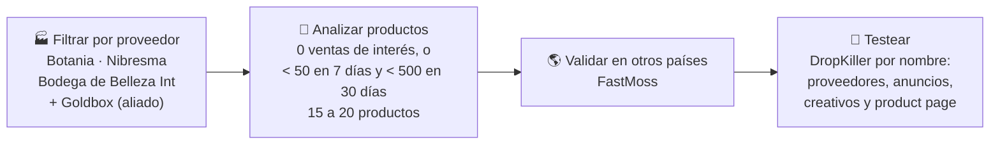
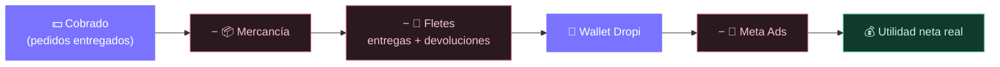

<div align="center">

# 💸 Synkops

### Mi ecommerce contra entrega, en un solo lugar

Acompaña cada producto de principio a fin: buscarlo, costearlo, montar su landing y su campaña,<br>
leer el testeo y medir la utilidad real cruzando **Dropi** con **Meta Ads**.

<sub>**Synkops · Mi operación en sincronía.** Antes "Calculadora de Utilidad Real".</sub>


<br>


<sub>Capturas con datos de ejemplo.</sub>

</div>

---

## 📚 Contenido

- [🧩 Las partes de la app](#-las-partes-de-la-app)
- [✨ Qué hace en 30 segundos](#-qué-hace-en-30-segundos)
- [🚀 Empieza en 4 pasos](#-empieza-en-4-pasos)
- [🔎 Buscar producto](#-buscar-producto)
- [🛍️ Desarrollo de la landing](#️-desarrollo-de-la-landing)
- [🎓 Entrenador de métricas](#-entrenador-de-métricas)
- [🧪 Testeo y 📈 Escalado](#-testeo-y--escalado)
- [🎨 Temas](#-temas)
- [📂 Los archivos que necesitas](#-los-archivos-que-necesitas)
- [🧭 Recorrido por el tablero](#-recorrido-por-el-tablero)
- [🧮 Cómo se calcula tu utilidad](#-cómo-se-calcula-tu-utilidad)
- [🎯 Metas NovaSociety y semáforos](#-metas-novasociety-y-semáforos)
- [💾 Guardar y compartir](#-guardar-y-compartir)
- [🔒 Privacidad](#-privacidad)
- [❓ Preguntas frecuentes](#-preguntas-frecuentes)
- [🛠️ Para desarrolladores](#️-para-desarrolladores)
- [✒️ Autor](#️-autor)
- [🎁 Propósito y agradecimientos](#-propósito-y-agradecimientos)
- [📜 Créditos y contacto](#-créditos-y-contacto)

---

## 🧩 Las partes de la app

Synkops es mi app personal: hoy la uso solo en mi PC y en el navegador. Quiero que centralice y automatice mi ecommerce, pero todavía no se conecta directamente con Dropi, Shopify ni Meta: los datos entran subiendo archivos o escribiéndolos a mano.

Todo vive en una sola página (`index.html`). Las pestañas de la barra superior siguen el orden en que trabajo un producto:

| Pestaña | Para qué sirve |
|---|---|
| 🏠 **Inicio** | Resumen del método de Juan Herrera (NovaSociety) y la cadena CPM → CPC → CPPI → CPA. |
| 🔎 **Buscar producto** | Encontrar y evaluar un producto antes de gastar: flujograma de DropKiller, mi candidato con score, bitácora y estrategias de búsqueda. Un botón flotante guarda productos al vuelo y otro arma el prompt para buscar en DropKiller. |
| 🧮 **Costeo** | Cuánto cobrar, cuánto me queda por pedido entregado y mi CPA máximo. |
| 🛍️ **Desarrollo** | Montar la landing del producto en Shopify y crear su campaña en Meta Ads, paso a paso. |
| 📏 **Métricas** | Guía de consulta de las métricas duras (CTR, CPC, CPM, CPPI, CPA) para Meta y TikTok: qué significa cada una, su fórmula, sus rangos, qué falla y cómo se arregla; y un glosario de las métricas base del Administrador de anuncios con las que se calculan. |
| 🧪 **Testeo** | Aprendo el testeo de NovaSociety: un paso a paso con los cortes de 20K / 30K / 40K, la cadena que reviso si apago, una práctica de 11 casos y un simulador de un conjunto. Es para aprender: no lee mis campañas reales. |
| 📈 **Escalado** | Pronto: aquí aprenderé a escalar un conjunto que ya pasó el testeo (Surfing Scaling). |
| 🪜 **Escalera** | Los 15 escalones para escalar (+20% de presupuesto cada uno). |
| 🎬 **Creativos** | Pipeline y cadencia de creativos, y cuándo el problema es el creativo. |
| 💸 **Tablero P&L** | La utilidad real contra entrega cruzando Dropi y Meta Ads (lo que explica la mayor parte de este documento). |

---

## ✨ Qué hace en 30 segundos

*Esta sección y las siguientes, hasta "Guardar y compartir", son del **Tablero P&L**.*

En contra entrega (COD) lo que vende Meta **no** es lo que entra a tu bolsillo: hay cancelaciones, devoluciones, fletes de ida y vuelta, y pedidos que siguen en ruta. Esta app hace la cuenta completa por ti.

| | |
|---|---|
| 💰 **Utilidad real** | Lo que queda de verdad después de mercancía, fletes, devoluciones y publicidad. |
| 🚦 **Veredicto al instante** | Cada producto y periodo sale como 🚀 Ganador, 🟡 Zona límite, ⚖️ Equilibrio o 🔻 En pérdida. |
| 📈 **¿Voy mejorando?** | Cada indicador se compara con el periodo anterior y muestra su tendencia semana a semana. |
| 🚚 **Plata en camino** | Estima cuánto sumarán los pedidos que todavía están en ruta. |
| 🎛️ **Simulador** | Mueve efectividad, inversión en Ads, ticket o costo de mercancía y mira la utilidad cambiar en vivo. |
| 📑 **Historia en palabras** | Un párrafo que explica qué pasó y cuál fue la causa principal. Listo para copiar a WhatsApp. |
| 📄 **Informe PDF** | Un documento listo para enviar, con plan de acción priorizado e impacto estimado en pesos. Se entiende sin abrir la app. |
| 📊 **Excel consolidado** | Guarda cada periodo como una fila en tu archivo histórico de 20 columnas. |

---

## 🚀 Empieza en 4 pasos

> [!TIP]
> No hay que instalar nada. Es una página web que corre en tu propio navegador.

**1. Abre la app** → haz **doble clic** en `index.html`. Se abre en tu navegador (recomendado: **Chrome** o **Edge**).

**2. Elige la pestaña** → para el P&L, abre **Tablero P&L**. Las demás pestañas no necesitan archivos.

**3. Arrastra tus reportes** → suelta los archivos de Dropi y Meta en las zonas de carga. No importa en qué cuadro los sueltes: la app reconoce cada archivo por su contenido y lo pone en su lugar.

**4. Lee tu tablero** → elige producto y fechas arriba. Todo se recalcula al instante.

> [!NOTE]
> La primera vez necesitas internet: la app descarga la librería que lee archivos Excel y las tipografías. Tus datos nunca se envían a ningún lado.

---

## 🔎 Buscar producto

Módulo 4 de NovaSociety más el método VDO de DropKiller. La idea: no preguntarme "¿qué producto vendo?", sino "¿qué problema le arde a la gente?", y dejar que los datos decidan. La ruta de arriba lleva a cada parte y resalta la sección en la que estoy (al tocarla o al desplazar la página):

| # | Parte | Qué hago ahí |
|:-:|---|---|
| 1 | **Flujograma DropKiller** | 7 pasos con sus filtros (ventas totales 100–2.000, 7 días 10–100, 30 días 100–500, stock mínimo 80…). Cada rombo es una decisión: si la respuesta es no, descarto. Marco los pasos hechos. |
| 2 | **Mi candidato** | Formulario con foto, ventas, proveedores, anunciantes y costos. Calcula solo el **score /8**, la **utilidad por entrega** y el semáforo **¿Lo testeo?** del método VDO. Al guardar, el producto se queda en el formulario (pasa a "Editando"); solo **🧹 Limpiar formulario** lo vacía. **Costear →** pasa el producto a la pestaña Costeo. |
| 3 | **Bitácora** | Los productos que voy evaluando. Lápiz = editar, papelera = eliminar, botones para copiar nombre e ID de Dropi. Filtros, búsqueda y vista de estadísticas. |
| 4 | **¿Es un producto ganador?** | 6 características (2 obligatorias). Las marco y se guardan con el candidato. |
| 5 | **Estrategias de búsqueda** | Dos caminos para encontrar el producto (ver abajo). |
| 6 | **Costeo →** | Salta a la pestaña Costeo con los datos del candidato. |

### ⚡ Guardado rápido

En esta pestaña hay un **botón flotante** (abajo a la derecha, encima del de Prompt DropKiller, con un numerito que cuenta lo guardado). Es una libreta para anotar productos al vuelo mientras busco; no calcula nada con ellos.

- **Formulario en una fila:** Nombre, ID Dropi, Precio proveedor e Imagen. Nombre e ID son obligatorios; el precio y la imagen son opcionales.
- **Precio:** lo escribo como `25000` o `25.000` y se ve como `$ 25.000`.
- **Imagen:** copio una imagen y, con el panel abierto, presiono **Ctrl+V** (o toco el cuadro para elegir un archivo). Se guarda pequeña, solo como referencia.
- **Lista:** cada producto muestra miniatura, nombre, ID y precio, con botón de copiar en nombre e ID. Un ID repetido no se guarda.
- **Ícono de enviar** (a la derecha de cada producto): lleva nombre, ID, precio y foto a **Mi candidato** como producto nuevo. Si Mi candidato tiene algo sin guardar, pregunta antes. El producto se queda en la lista.
- **Papelera** (al lado del de enviar): elimina solo ese producto de la lista; pregunta antes, como en la bitácora.
- **🧹 Limpiar:** pregunta antes y vacía solo esta lista (libera el espacio de las fotos). Lo que ya envié a Mi candidato no se toca.

### 🧠 Prompt DropKiller

Junto al Guardado rápido hay un segundo **botón flotante azul** (esquina de abajo a la derecha, con el logo de DropKiller). Arma el prompt para buscar diamantes en bruto con el **MCP de DropKiller** bajo el método VDO: lo copio, lo pego en Claude y los resultados se quedan allá.

- **Filtros:** ventas totales (mín./máx., con el aviso «Tolero hasta 3.000»), proveedores, ventas recientes (7 o 30 días), fecha de creación (3 o 6 meses), stock (mínimo 80, máximo vacío = sin máximo), veces restockeado y categoría. Si dejo un campo vacío, el prompt usa el valor que se ve en gris.
- **Categoría:** vacía = «Todos (Salud, Belleza y bienestar primero)»; el prompt la abre a cualquier nicho pero prioriza esos y exige el perfil de producto del punto 8.
- **Números:** enteros (acepta `2.000`). Si algo no es válido o el mínimo supera al máximo, el campo se marca en rojo y no se genera el prompt.
- **✨ Generar prompt** lo arma con los filtros; **📋 Copiar prompt** lo copia y avisa. El cuadro **no se llena solo** al cambiar un campo y **queda limpio cuando cierro la ventana** (✕, Esc o el botón); los filtros se conservan hasta recargar la página.
- País (Colombia), plataforma (Dropi) y los 5 resultados van fijos. Nada se guarda en el navegador.
- Abrir este panel cierra el del Guardado rápido, y al revés.

### 🧭 Estrategias de búsqueda

Elijo una de las dos tarjetas de arriba; la app recuerda cuál dejé abierta.

**🎯 Estrategia VDO**: parto de productos que ya están en validación.

- **V**alidación: 100 a 2.000 ventas totales, sumando todos los proveedores.
- **D**emanda: menos de 5 proveedores (máximo 10).
- **O**ferta: menos de 5 anunciantes activos.
- Además: la **pirámide del producto ganador** (producto y oferta 50%, creativos 30%, landing 20%) y el **ciclo de vida** del producto (nuevo, validación, escalado, saturado, quemado).

**🏭 Estrategia por proveedor**: parto de proveedores confiables y busco productos que casi nadie vende.



En **FastMoss** (enlace directo a [fastmoss.com/es](https://www.fastmoss.com/es) desde la app) sigo 4 pasos: país objetivo → volumen de ventas → competencia local → anuncios y creadores. Si el producto pasa, lo anoto en **Mi candidato** y lo costeo antes de testear con los cortes 20K / 30K / 40K.

> [!NOTE]
> Los números de la estrategia por proveedor (50 / 500 / 15–20) son distintos a los del filtro VDO (máximo 100 en 7 días) a propósito: son métodos diferentes.

---

## 🛍️ Desarrollo de la landing

Módulo 5 de NovaSociety: lo que hago a mano para montar el producto en Shopify. La descripción en HTML la entrega la skill de Claude **"Mi Página Vida Nova"**; la pestaña guía el resto, paso a paso y con casillas que se guardan. Las sub-pestañas van numeradas (**1** Landing en Shopify, **2** Meta Ads, **3** TikTok Ads · pronto):

- **Landing en Shopify** en 7 pasos: Antes de empezar → Generar la página → Recursos de la página → Vincular con Dropi → Formulario y ofertas → Reseñas → Revisión final (su botón lleva a Meta Ads).
- **Generar la página:** prompts para alimentar la IA, el título y la skill; precios para Shopify (precio y precio de comparación), identificador de URL y la **URL de la product page** lista para copiar (la misma del paso 1 de Meta Ads: se edita en cualquiera de los dos).
- **Recursos de la página:** prompts de las 13 imágenes y del **manual de regalo en PDF** (skill `/manual-producto-pdf`: escribo la dosis de la etiqueta, toco *Generar prompt* y sale con el nombre y el ID de Dropi del producto); al final, subir todo a *Contenido → Archivos* y pegar sus URL en el HTML.
- Dropify e inventario.
- **Releasit** con ofertas de 1, 2 y 3 unidades (descuentos de 0%, 20% y 30%).
- Títulos y etiquetas con unidad, regalo y garantía; prompts de miniaturas.
- **Reseñas** (TrustWill): primero reúno mínimo 6 imágenes reales del producto (Amazon o similares); si no existen, hay un prompt para generarlas con IA.
- **Traer de mi candidato** llena nombre, ID de Dropi y precios desde Buscar producto.
- **Meta Ads:** paso a paso según la estrategia que voy a montar (selector ABO / CBO; CBO aparece como "pronto"). ABO: campaña de testeo (1 campaña → 4 conjuntos → 1 anuncio con su video en cada uno, 30.000 al día por conjunto). Mapa informativo de la campaña, tabla "campo → valor" en cada paso, nombre de la campaña (día de mañana, mes y primer nombre del producto), fecha de inicio (mañana, 5:00 a. m.), URL de la product page con identificador editable, ciudades excluidas de Lugares y prompt de 3 copies, títulos y descripciones.
- TikTok Ads aparece como "pronto".

### 📣 Prompt buscar anuncios

En esta pestaña hay un **botón flotante verde** (esquina de abajo a la derecha, con un megáfono y una lupa). Arma el prompt para buscar con el **MCP de DropKiller** los anuncios que ya corren de mi producto: lo copio, lo pego en Claude y adjunto la imagen.

- **Campos:** Nombre del producto (obligatorio), Imagen, Días activos, Última vez visto y País a excluir. Si dejo un campo vacío, el prompt usa el valor que se ve en gris (7 días, 7 días, Colombia).
- **Imagen:** es solo un recordatorio de cuál adjuntar en Claude; el prompt es texto. Se importa, se pega con **Ctrl+V** o se elige como archivo.
- **📥 Importar** trae el nombre y la imagen del producto abierto en **Mi candidato**. Si no hay ninguno, avisa.
- **Días:** escribo solo el número (`14`); el prompt arma «Mínimo 14 días». Si no es un entero de 1 o más, el campo se marca en rojo y no se genera el prompt.
- **Botones:** arriba, **📥 Importar** y **📋 Copiar prompt**; abajo, **🧹 Limpiar** (deja campos, imagen y prompt en blanco, sin preguntar) y **✨ Generar prompt**.
- El cuadro **no se llena solo** al cambiar un campo y **queda limpio cuando cierro la ventana** (✕, Esc o el botón); los campos se conservan hasta recargar la página. Nada se guarda en el navegador.
- «buscar USA, España, LATAM» va fijo en el prompt.

---

## 🎓 Entrenador de métricas

Las pestañas Inicio, Costeo, Métricas, Escalera y Creativos siguen el método de Juan Herrera:

- **Costeo:** el precio sale del margen que quiero, redondeado a x4.900 / x9.900 (igual que el MCP de NovaSociety). Calcula el CPA máximo, la zona de escala y la zona de apagar. Con **Poner este precio en mi candidato** el precio vuelve a Buscar producto.
- **Lectura de métricas:** arriba, una ruta (resalta la sección en la que estoy) para saltar a cada sección (Métricas duras, Métricas base, Métricas blandas, La cadena que decide todo) y un botón **Testeo →**.
- **Métricas duras:** un diagrama animado "Las 5 métricas más importantes" (TikTok · ¿Cómo se logra? · Meta) con CTR, CPC, CPM, CPPI y CPA. Es una guía de orientación con números fijos, no usa mis datos.
  - Paso el mouse por un **número** y veo su límite máximo permitido en esa plataforma (y el rango ideal); por **¿Cómo se logra?**, una tabla con el diagnóstico si falla y la palanca de solución.
  - El botón **i** de cada métrica abre una explicación en palabras simples: qué mide, su **fórmula**, una comparación cotidiana y su semáforo de señales. En CTR y CPPI dice además cómo se llaman en el reporte de Meta.
  - En Meta el CTR es el **CTR único** (cuenta personas, no impresiones). Se mantiene el límite de 2 %, con un aviso ⚠ de que falta confirmar el límite propio del CTR único.
  - Con **Expandir** (o un clic en un espacio vacío de la tarjeta) el diagrama se ensancha para ver mejor las flechas.
  - **Métricas base** (se abre con **Abrir +**): una tabla con Presupuesto, Monto gastado, Impresiones, Clics en el enlace y Resultados: qué es cada una, qué métrica dura da (con su fórmula) y la nota de NovaSociety. Al pie, Pagos iniciados → CPPI («Costo x Checkout»).
  - **Métricas blandas:** reservada para más adelante.
  - Debajo está la tarjeta **La cadena que decide todo** (la misma de Inicio), con las métricas antes y después del clic; al tocar un paso se abre su desplegable.
- **Escalera:** 15 escalones de +20%, decididos con el CPA de los últimos 3 días.
- **Creativos:** pipeline, meta semanal y diagnóstico de si el problema es el creativo.

---

## 🧪 Testeo y 📈 Escalado

**Testeo** es una pestaña para **aprender** cómo se decide en el testeo, la primera prueba de un anuncio. No lee mis campañas ni mis datos: los casos son inventados. Las reglas son las de NovaSociety (las del MCP de NovaSociety), y las frases de cada veredicto son las del Lab.

Tiene tres sub-pestañas: **📂 Lectura real · pronto** (subir el reporte de mis campañas y que la app diga qué hacer con cada conjunto; se ve apagada y todavía no se puede abrir), **🧪 Fase de testeo** (el paso a paso con su práctica) y **🎛️ Simulador** (configuro una cadena y veo qué decide el Lab en cada corte).

**Escalado** es la pestaña que sigue a Testeo. Hoy solo anuncia **🏄 Surfing Scaling** (escalado vertical +20 %, niveles de presupuesto y refresco de campañas) con una tarjeta "Pronto".

**Fase de testeo** es un paso a paso, como la guía de Meta Ads: lista de pasos a la izquierda, el detalle a la derecha y una barra de avance. Marco cada paso como hecho y se guarda en este navegador.

1. **Arranque:** el testeo empieza con $ 100.000 al día y se mide por **gasto acumulado**, no por horas ni días. Una barra muestra los cortes de 20K, 30K y 40K, que caen el mismo día. Con la guía ABO (4 conjuntos × $ 30.000) el corte de 40K le llega a cada conjunto el día 2.
2. **Corte 1 · 20.000:** miro los pagos iniciados. Con venta, maravilloso y sigo al siguiente corte sin tocar; 0 a 2 sin ventas se apaga y reviso la cadena; 3 o 4, flojo; 5 o más, bien. Cada fila del mapa trae al lado una etiqueta de color (como un botón) con la acción: ✅ MARAVILLOSO, 🛑 Apagar, ⚠️ Mantener vigilando o ✅ Seguir sin tocar. Los pasos 2 a 4 no iluminan ninguna fila.
3. **Corte 2 · 30.000:** miro el CPPI (gasto ÷ pagos iniciados), sin ventas y con venta.
4. **Corte 3 · 40.000:** miro ventas y CPA contra el tope. Con 2 ventas o más y CPA dentro del tope, se deja gastar el día. Con 1 venta, o 2 o más con CPA sobre el tope, **apago** ("NO CUMPLE · APÁGALO", luz roja): con 1 venta a 40.000 el CPA ya es 40.000 o más y seguir es gastar con pérdida. Esa es una **regla propia**: el MCP no la da, queda por aclarar y la app la marca con la etiqueta **❓ Preguntar**, que explica el caso en un tooltip al pasar el mouse. Una caja explica de dónde sale el tope (el CPA máximo del costeo) y sus zonas de escala y apaga.
5. **La cadena y qué no hacer:** CPM → CPC → CPPI → CPA y qué revisar en cada caso ("Si… / Solución…"), más **Lo que no hago**: no apagar antes de un corte, no tocar el anuncio mientras está en testeo y no decidir por el CTR.
6. **Practica:** 11 casos inventados, en orden al azar. El botón verde **Empecemos →** (después, **Avanzar hasta el corte N →**) llena la barra hasta el siguiente corte y aparecen los números, incluidos el CPM (informativo) y el tope de cada caso. Elijo entre Apagar, Mantener vigilando, Seguir sin tocar o Dejar gastar el día; la app dice si acerté, por qué y me lleva al paso que lo explica. Algunos casos traen una nota que enseña por qué (por ejemplo, un CPM caro no apaga si la cadena funciona). Al final veo mis aciertos y mi mejor puntaje, que se guarda. Debajo, el botón **Simulador →** abre la sub-pestaña del simulador. Las tarjetas de los tres cortes van una debajo de la otra.

**🎛️ Simulador** es una sub-pestaña aparte: configuro un conjunto y la app corre el gasto con un poco de azar (como en Meta: dos corridas iguales pueden dar cortes distintos) y me dice qué decide el Lab en cada corte. Tiene dos modos:

- **🔗 Cadena** (abre por defecto): elijo plataforma (Meta o TikTok, solo cambia las luces del semáforo), presupuesto diario, CPA tope, **CPM**, **CTR** (acepta coma: `1,5`), **% de clics que inician pago** y **% de pagos iniciados que compran**. El CPC, las impresiones, los clics, los pagos iniciados, las ventas, el CPPI y el CPA salen calculados: no se escriben.
  - **▶ Correr** llena el gasto de a $ 1.000 cada 120 ms y se **pausa en cada corte** (20K, 30K, 40K) y al fin del día, con el veredicto del Lab. **Continuar ▶** sigue. También hay ⏸ pausa, ⏮ volver a 0, 🎲 otra corrida (mismas entradas, otro azar) y un deslizador para mover el punto a mano. Con movimiento reducido en el sistema, ▶ salta de corte en corte sin animar.
  - Si un corte da **Apagar**, la corrida se detiene ahí y sale «Apagado en el corte N» con qué revisar.
  - **Cadena con semáforo:** CPM → CTR → CPC → CPPI → CPA, cada uno con su luz. El CTR va sin luz y dice «No decide» (NovaSociety no lo mira). Si un eslabón se rompe, debajo sale su lectura «Si… / Solución…».
  - **Historial de cortes:** 20K · 30K · 40K · Fin del día, con lo que dio la corrida en cada uno (— si aún no llega; «Apagado» si ya se apagó).
  - **Escenarios:** 💸 CPM caro, 😐 Producto no interesa, 🧱 Página no convierte y 🏆 Ganador cargan una cadena de ejemplo y arman una corrida nueva. Como hay azar, a veces no caen donde se espera: pruebo otra corrida.
  - Al fin del día, si el corte 3 dio «Dejar gastar el día», la app avisa que dejó de ser testeo y pasa a Escalado.
- **🎛️ Números a mano:** cambio presupuesto, gasto, pagos iniciados, ventas y tope, y veo el corte, el día del testeo, el CPPI, el CPA y qué diría el Lab (antes se llamaba «Juega con los números» y vivía en el paso 6).

---

## 🎨 Temas

El botón de tema de la barra superior cambia los colores de toda la app: **Dark** (por defecto), **Light**, **Gold** (negro y amarillo NovaSociety), **Ember**, **IntelliJ Dark**, **IntelliJ Gold** y **Nebula**. La app recuerda el que elegí.

---

## 📂 Los archivos que necesitas

<p align="center"></p>

| Archivo | ¿De dónde lo saco? | ¿Qué aporta? | ¿Obligatorio? |
|---|---|---|:---:|
| 📦 **Reporte de órdenes Dropi** <br><sub>`.xlsx` o `.csv` separado por `;`</sub> | Dropi → Reportes → Órdenes | Pedidos, estados, cobrado, costo de proveedor y fletes | ✅ Sí |
| 💳 **Facturación de Meta** <br><sub>`.csv`</sub> | Meta → Facturación → Transacciones | El gasto **real** cobrado a tu tarjeta, día a día (con IVA) | ⭐ Muy recomendado |
| 📣 **Métricas de campañas** <br><sub>`.csv`</sub> | Administrador de anuncios → Exportar (mejor con desglose por **Día**) | Reparto del gasto por producto, compras y CTR | Opcional |

<details>
<summary><b>🔎 ¿Cómo interpreta la app cada archivo?</b></summary>

<br>

- **Dropi:** cada orden se clasifica por su `ESTATUS` en **entregada**, **devuelta**, **cancelada** (también rechazada o anulada) o **en ruta**. Los obsequios se suman al producto principal de su orden.
- **Facturación Meta:** en cuentas **prepago** solo cuenta el gasto descontado del saldo, no las recargas con tarjeta (si se sumaran ambos, la inversión saldría duplicada). Se omiten los cobros fallidos o reembolsados.
- **Métricas de campañas:** cada campaña se asigna a un producto de Dropi por su nombre. Si se equivoca, lo corriges en la tabla *Campañas Meta* y la app lo recuerda.
- **Sin facturación:** la inversión sale de las métricas de campañas × 1,19 (IVA).
- **Sin ningún archivo de Meta:** puedes escribir la inversión a mano en el filtro *Inversión Ads manual*.

</details>

---

## 🧭 Recorrido por el tablero

### 🎚️ 1. Filtros

| Control | Para qué sirve |
|---|---|
| **Producto** | Ver un producto o el consolidado. Al elegir uno, las fechas saltan a su ciclo real en Dropi. |
| **Fecha inicial / final** | El rango a analizar (por fecha del pedido). |
| **Con IVA 19% / Sin IVA** | *Con IVA* = lo que cobró la tarjeta. *Sin IVA* = el gasto bruto de Meta (cargo ÷ 1,19). |
| **Inversión Ads manual** | Reemplaza la inversión automática solo para este periodo. |
| **Campaña / Compras / CTR** | Datos que se guardan en el Excel consolidado. Si los dejas vacíos se usan los automáticos. |
| **Periodos rápidos** | Botones con el ciclo de cada producto. Si un producto tuvo obsequio, aparecen las etapas *antes* y *después*. |

### 🧾 2. Veredicto y tarjetas KPI

Arriba ves el **veredicto** del filtro y cómo se reparte cada peso cobrado entre mercancía, fletes y Meta Ads. Debajo, cinco tarjetas. Pasa el mouse por el ícono **ⓘ** de cada una para ver su explicación.

| Tarjeta | Qué te dice | Cómo leerla |
|---|---|---|
| 💰 **Utilidad neta real** | Lo que queda en tu bolsillo | Verde = ganas · Rojo = pierdes |
| 📊 **Margen neto real** | De cada $100 cobrados, cuántos son ganancia | Meta: **15% a 20%** |
| 🚚 **Efectividad de entrega** | De los pedidos que ya cerraron, cuántos se cobraron | Meta: **70%+** |
| 📈 **ROAS real** | Pesos cobrados por cada $1 en anuncios | Debe superar el **equilibrio** |
| 🎯 **CPA real por entrega** | Publicidad gastada por cada cliente que pagó | Debe ser menor al **máximo sostenible** |

Cada tarjeta trae además:

- **▲ / ▼ vs. periodo anterior:** compara con un rango de la misma duración justo antes. En verde si mejoró, en rojo si empeoró (en el CPA, bajar es mejorar). Pasa el mouse para ver las fechas y el valor anterior.
- **Comparación justa con pedidos en ruta:** si hay pedidos sin cerrar, la tarjeta de utilidad agrega una segunda línea que compara las utilidades **proyectadas** de ambos periodos. Así un periodo reciente no se ve peor solo porque aún no ha cobrado todo.
- **Mini-gráfica semanal:** la tendencia del indicador, semana a semana.
- **Semáforo:** el punto de color con el estado frente a la meta.

### 🚚 3. Pedidos en ruta

Si hay pedidos viajando, una franja te dice cuánto sumarían **si se entregan con tu efectividad actual**. La publicidad de esos pedidos ya está pagada, así que cada entrega extra es casi pura ganancia.

### 📑 4. Resumen ejecutivo

Un botón desplegable que conecta las cinco tarjetas en **un solo párrafo**: qué pasó, por qué y cuál fue la causa principal (pauta costosa, fletes de devolución o ambas). Hay una versión para cada escenario: ganador, zona límite, equilibrio y pérdida. Se reescribe solo cada vez que cambias producto o fechas. Desde ahí puedes **copiarlo** o generar el **informe PDF**.

### 📊 5. Cascada y embudo

<p align="center"></p>

- **De lo cobrado a tu bolsillo:** cada barra resta un costo hasta llegar a la utilidad. Abajo, el *Diagnóstico Financiero* evalúa cada paso contra su meta.
- **Embudo logístico COD:** recibidos → cancelados → despachados → entregados / devueltos / en ruta. Puedes verlo en **unidades** o en **porcentajes**, y abrir el *Diagnóstico vs. Benchmark* con su conclusión.

### 🎛️ 6. Tendencia semanal y simulador

<p align="center"></p>

- **Tendencia semanal:** utilidad por semana (lunes a domingo). Las barras tenues son semanas incompletas en el rango. Las semanas más recientes suelen verse peor porque aún tienen pedidos en ruta.
- **Simulador ¿qué pasa si?:** cuatro palancas sobre los mismos pedidos cerrados del filtro:

  | Palanca | Pregunta que responde |
  |---|---|
  | Efectividad de entrega | ¿Y si la transportadora entregara más? |
  | Inversión en Meta Ads | ¿Y si consigo los mismos pedidos gastando menos en anuncios? |
  | Ticket promedio | ¿Y si vendo combos o subo el precio? |
  | Mercancía por entrega | ¿Y si negocio mejor con el proveedor? |

  Muestra la utilidad simulada, su diferencia con lo real, el CPA resultante y el **CPA máximo para lograr un margen del 15%**. El presupuesto de Ads es total: si subes la efectividad, la misma inversión se reparte en más entregas y el CPA baja solo. Cuando mueves una palanca, el botón **↺ Volver a lo real** se ilumina.

> [!TIP]
> Si simulas un combo, sube el **ticket** *y también* la **mercancía por entrega**: el combo cuesta más producto.

### 🧩 7. Unit economics

<p align="center"></p>

Cómo se reparte el **ticket promedio** de un pedido entregado: mercancía, fletes, devoluciones, publicidad y utilidad. La fila clave es el **Margen Máximo para Publicidad (CPA sostenible)**: si tu publicidad por entrega lo supera, pierdes dinero.

### 🏷️ 8. Desglose por producto

<p align="center"></p>

Todos tus productos lado a lado, con su **veredicto** y una **barra de utilidad** para ver de un vistazo cuál escalar y cuál apagar. **Haz clic en una fila** para filtrar el tablero por ese producto.

### 📣 9. Campañas Meta

Aparece si cargas el reporte de métricas. Muestra gasto, compras, CPA de Meta y CTR por campaña, y te deja **cambiar el producto asignado** a cada una. Tus correcciones quedan guardadas en el navegador.

---

## 🧮 Cómo se calcula tu utilidad



| Indicador | Fórmula |
|---|---|
| **Wallet Dropi** | Cobrado − Mercancía − Fletes (entregas + devoluciones ida y retorno) |
| **Utilidad neta real** | Wallet − Meta Ads |
| **Margen neto** | Utilidad ÷ Cobrado |
| **Efectividad** | Entregados ÷ (Entregados + Devueltos) |
| **ROAS real** | Cobrado ÷ Meta Ads |
| **ROAS de equilibrio** | Cobrado ÷ Wallet |
| **CPA real** | Meta Ads ÷ Entregados |
| **CPA máximo sostenible** | Wallet ÷ Entregados |

> [!IMPORTANT]
> Las tres reglas de oro dicen lo mismo de tres formas: **pierdes dinero** cuando la utilidad es negativa, que es justo cuando el **CPA supera el máximo sostenible** y cuando el **ROAS queda por debajo del equilibrio**.

<details>
<summary><b>📐 ¿Cómo se reparte la inversión de Meta entre productos?</b></summary>

<br>

1. Se suman los cargos de facturación con fecha dentro del rango.
2. Cada cargo se asigna al producto que tenía **pedidos activos en esa fecha** (según su ciclo en Dropi).
3. Si dos productos estaban activos el mismo día, el cargo se divide según el gasto de sus campañas.
4. *Con IVA* usa el cargo de la tarjeta; *Sin IVA* lo divide entre 1,19.

</details>

---

## 🎯 Metas NovaSociety y semáforos

| Métrica | 🟢 Sano | 🟡 Atención | 🔴 Alerta |
|---|---|---|---|
| Margen neto | ≥ 15% *(ideal 20%)* | −2% a 15% | < −2% |
| Efectividad de entrega | ≥ 70% | 60% a 70% | < 60% |
| ROAS frente al equilibrio | ≥ 15% por encima | Apenas por encima | Por debajo |
| CPA frente al máximo | ≥ 15% por debajo | Apenas por debajo | Por encima |
| Tasa de devolución | ≤ 25% | > 25% | — |
| Cancelación en WhatsApp | 15% a 25% | < 15% o 25% a 30% | > 30% |
| Retención tras mercancía | ≥ 70% | < 70% | — |
| Wallet sobre lo cobrado | ≥ 45% | < 45% | — |
| Fletes sobre lo cobrado | ≤ 25% | 25% a 35% | ≥ 35% |
| Meta Ads sobre la Wallet | ≤ 60% | 60% a 100% | ≥ 100% |
| Efectividad global (entregados ÷ recibidos) | ≥ 60% *(Meta Reina)* | 50% a 60% | < 50% |

**Veredicto** del encabezado y de la tabla de productos:

| Veredicto | Cuándo aparece |
|---|---|
| 🚀 **Ganador** | Ganancia con margen de 15% o más |
| 🟡 **Zona límite** | Ganancia, pero con margen menor a 15% |
| ⚖️ **Equilibrio** | Margen entre −2% y +2% |
| 🔻 **En pérdida** | Utilidad negativa |

---

## 💾 Guardar y compartir

| Acción | Qué hace |
|---|---|
| 📊 **Guardar en consolidado** | Agrega la fila del filtro actual a tu `Utilidad_Consolidado_Global.xlsx` (hoja *Registro*, 20 columnas con fórmulas). La primera vez eliges el archivo o creas uno nuevo; la app lo recuerda. Si ya existe ese periodo + producto + campaña, te pregunta si sobrescribir o agregar. |
| 📤 **Exportar a Excel** | Descarga un Excel nuevo solo con la fila del filtro actual. |
| 🔁 **Cambiar archivo** | Vincula otro consolidado. |
| 📋 **Copiar resumen** | Copia título, veredicto, KPIs e historia en texto para pegar en WhatsApp o correo. |
| 📄 **Descargar informe PDF** | Botón arriba a la derecha: genera un informe completo para enviar a quien no tiene la app (ver abajo). |

### 📄 El informe PDF

<p align="center"></p>

Pulsa **📄 Descargar informe PDF** (el botón morado arriba a la derecha, o *Informe PDF* dentro del resumen ejecutivo) y, en la ventana de impresión, elige **Guardar como PDF**. El archivo se nombra solo con el producto y el periodo. Es un documento claro, en tamaño carta/A4, pensado para que un socio, inversionista o asesor entienda la operación **sin acceso a la app**:

| # | Sección | Qué contiene |
|:-:|---|---|
| — | **Portada** | Producto, periodo, veredicto y las 4 cifras clave: cobrado, invertido, utilidad y margen. |
| 1 | **Resumen ejecutivo** | La historia del periodo en palabras, cómo se repartió cada peso cobrado y la plata que viene en camino. |
| 2 | **Plan de acción** | Acciones ordenadas por el dinero que mueven, con prioridad y **utilidad extra estimada en pesos**. |
| 3 | **Indicadores clave** | Los 5 KPIs con su explicación, referencia, estado y cambio frente al periodo anterior. |
| 4 | **De lo cobrado al bolsillo** | La cascada en tabla con el diagnóstico financiero. |
| 5 | **Logística contra entrega** | El embudo de pedidos con el diagnóstico frente al benchmark. |
| 6 | **Economía por pedido** | Cuánto deja cada entrega y en qué se va. |
| 7 | **Tendencia semanal** | Utilidad, margen, ROAS y efectividad semana a semana. |
| 8 | **Resultado por producto** | Cada producto con su veredicto (si hay más de uno). |
| 9 | **Glosario y notas** | Qué significa cada término, más las fuentes y supuestos del cálculo. |
| — | **Firma** | Autor de la aplicación y fecha de generación del informe. |

> [!NOTE]
> Los impactos del plan de acción se calculan con el simulador: mismos pedidos cerrados del periodo, cambiando una sola variable a la vez. Por eso **no se suman** entre sí.

> [!WARNING]
> **Cierra el consolidado en Excel antes de guardar**: si está abierto, Windows bloquea el archivo y la app no puede escribirlo.
>
> Guardar directo sobre el archivo solo funciona en **Chrome o Edge**. En otros navegadores se descarga una copia actualizada para que reemplaces el original.

---

## 🔒 Privacidad

- 🖥️ Todo se procesa **dentro de tu navegador**. Tus reportes no se suben a ningún servidor.
- 💾 Lo que la app guarda en tu navegador: asignaciones campaña → producto, acceso a tu archivo consolidado, la bitácora de candidatos (con sus fotos), el guardado rápido de productos y los pasos marcados de Buscar producto, Desarrollo y Testeo (con tu mejor puntaje de práctica y las entradas del Simulador), lo que escribes en el entrenador y el tema elegido. Si borras los datos del navegador, eso se pierde.
- 🌐 Solo usa internet para descargar la librería de Excel y las tipografías, y cuando abres un enlace externo (por ejemplo, FastMoss).

---

## ❓ Preguntas frecuentes

<details>
<summary><b>¿Por qué la semana más reciente se ve tan mal?</b></summary>
<br>
Porque muchos de sus pedidos siguen en ruta: la publicidad ya se pagó pero el cobro todavía no llega. Mira la franja de <b>pedidos en ruta</b> para ver la utilidad proyectada.
</details>

<details>
<summary><b>No me aparece la comparación con el periodo anterior.</b></summary>
<br>
Solo se muestra si en el rango anterior (misma duración, justo antes) hubo pedidos cobrados. Si eliges todo el historial, no hay periodo anterior con qué comparar.
</details>

<details>
<summary><b>La inversión de Meta no me cuadra.</b></summary>
<br>
Revisa los avisos azules bajo las zonas de carga: indican si se excluyeron recargas prepago, cobros fallidos, gasto de campañas sin producto asignado o divisas distintas a COP. También verifica el botón <b>Con IVA / Sin IVA</b>.
</details>

<details>
<summary><b>Una campaña quedó asignada al producto equivocado.</b></summary>
<br>
En la tabla <b>Campañas Meta</b> cambia el producto en su lista desplegable. La app lo recuerda para la próxima vez.
</details>

<details>
<summary><b>¿El simulador cambia mis datos?</b></summary>
<br>
No. Es solo una calculadora de escenarios: nada de lo que muevas ahí afecta las tarjetas, el Excel ni el resto del tablero.
</details>

<details>
<summary><b>No puedo abrir archivos .xlsx.</b></summary>
<br>
La librería de Excel se descarga de internet. Abre la app con conexión; si no la tienes, exporta el reporte de Dropi como <code>.csv</code>.
</details>

---

## 🛠️ Para desarrolladores

<details>
<summary><b>Arquitectura, convenciones y pruebas</b></summary>

<br>

Sin build, sin servidor y sin dependencias npm. Única librería externa: [ExcelJS](https://github.com/exceljs/exceljs) por CDN.

### Capas

Cada capa solo usa las que están por encima en esta lista:

```
specs/                Specs del proyecto; 00-estado-actual.md es la línea base

img/
  autor.png           Logo del autor (pie de la app y del informe)

docs/referencia/
  novasociety-metricas-v2.html   Prototipo original del entrenador (referencia, no se carga)

css/
  base.css            Sistema de diseño: tokens, barra superior, tarjetas, botones, campos, tablas,
                      aviso, indicador de desplegable y alias de tokens del tablero
  modules/            Un CSS por módulo, en este orden de carga (la cascada depende de él):
    trainer.css       Entrenador: Inicio, Costeo, escalera y pipeline
    search.css        Buscar producto, Mi candidato, bitácora y estadísticas
    quick.css         Guardado rápido (título del panel con barrita de acento)
    dkprompt.css      Prompt DropKiller: botón azul y panel con los filtros; título del panel con barrita (--fab)
    landing.css       Desarrollo → Shopify
    ads.css           Desarrollo → Meta Ads
    adprompt.css      Prompt buscar anuncios: botón verde (reutiliza .dk-* y .qk-photo*)
    metrics.css       Métricas: ruta, diagrama de métricas duras, avisos, panel "i", botón Expandir y tabla de Métricas base
    testing.css       Testeo: barra de gasto, tarjetas de corte, práctica y Simulador
  themes.css          Selector de tema, modo claro, temas oscuros y SVG con colores fijos
  modules/pnl.css     Solo lo propio del Tablero P&L (acotado a #v-pyl)
  report.css          Informe PDF: documento claro en A4, visible solo al imprimir

tests/
  core.test.js        Núcleo en Node puro (costeo, guardado rápido, prompt DropKiller, prompt buscar anuncios, simulador de testeo, P&L)
  smoke.test.js       jsdom: claves de PYL.*, 10 pestañas, navegación, paneles Prompt DropKiller y Prompt buscar anuncios, Simulador de testeo y consola limpia
  fixtures/           CSV de prueba de Dropi (datos inventados) y claves de PYL.*

js/
  index.js            Solo Node: carga todos los core en orden y exporta el núcleo para pruebas

  shared/             Lo que usan varios módulos
    core/             parse.js (texto, números, CSV, celdas de ExcelJS), dates.js (fechas ISO), format.js (es-CO)
    services/         storage.js (localStorage e IndexedDB), files.js (lectura de .xlsx/.csv, selector, descarga)
    ui/               dom.js, tooltip.js, feedback.js

  modules/            Una carpeta por parte de la app, con sus capas adentro
    pnl/              Tablero P&L
      core/           dropi.js, meta.js, pnl.js, diagnostics.js, insights.js, excel.js
      services/       consolidado.js (archivo consolidado con File System Access, Chrome/Edge)
      ui/             upload-zones, notices, trend, summary, cascade, funnel, diagnosis-panel, unit-table,
                      simulator, products-table, campaigns-table, presets y report
      app/            filters.js, data-loader.js, save.js, report.js
    search/           Buscar producto
      core/search.js  LIMITS (única fuente de los umbrales), ciclo de vida, flujograma, estrategias (VDO y
                      por proveedor), producto ganador, score, costeo y bitácora
      ui/             search.js (flujograma, semáforo VDO, pirámide, estrategias, fichas) y
                      candidate.js (evaluador: formulario con foto, score /8, utilidad, bitácora y estadísticas)
      app/search.js   Estado (app.state.search) y paso del candidato al Costeo
    quick/            Guardado rápido
      core/quick.js   Valida (nombre, ID, ID repetido), arma la lista, quita un producto y convierte el precio escrito a pesos
      ui/quick.js     Botón flotante, panel con formulario en fila y lista
      app/quick.js    Estado (app.state.quick) y envío a Mi candidato (evento rapido:candidato)
    dkprompt/         Prompt DropKiller (SPEC 09)
      core/dkprompt.js Valores por defecto, validación (dkValues) y plantilla del prompt (dkPrompt); sin DOM
      ui/dkprompt.js  Botón flotante con el logo, cuadrícula de filtros y cuadro del prompt
      app/dkprompt.js Estado (app.state.dkprompt: open, form, last), Generar, Copiar y cierre con Esc
    adprompt/         Prompt buscar anuncios (botón flotante verde en Desarrollo)
      core/adprompt.js Valores por defecto, validación (apValues), importar de Mi candidato (apImport) y plantilla (apPrompt); sin DOM
      ui/adprompt.js  Botón flotante con megáfono y lupa, formulario (nombre, imagen, días activos, última vez visto, país) y cuadro del prompt
      app/adprompt.js Estado (app.state.adprompt: open, form, photo, last), Importar, Generar, Copiar y cierre con Esc
    landing/          Desarrollo → Shopify (core: pasos, prompts y números LANDING · ui · app)
    ads/              Desarrollo → Meta Ads (core: AD_STRATEGIES, ABO_STEPS y ADS · ui: mapa y herramientas · app)
    metrics/          Métricas → métricas duras (SPEC 03) y Métricas base (SPEC 04)
      core/metrics.js Datos de las 5 métricas (números, avisos, diagnóstico, significado, fórmulas, nombre en el reporte) y de Métricas base
      ui/metrics.js   Diagrama, flechas SVG, avisos, panel "i", botón Expandir y tabla de Métricas base
      app/metrics.js  Estado (app.state.hardMetrics), flechas, expandir, Métricas base y ruta
    testing/          Testeo (SPEC 05 y 06): módulo informativo, no lee campañas reales
      core/testing.js Reglas del testeo (`testVerdict`, `cpaZones`), partes, pasos, mapa de cortes, cadena, banco de 11 casos, práctica y "Números a mano" (`testFree`)
      core/simulator.js Simulador de un conjunto (SPEC 11): azar con semilla, corrida, cadena con semáforo, eslabón roto, escenarios y entradas guardadas
      ui/testing.js   Sub-pestañas, tarjeta "Pronto", barra de gasto, tarjetas de corte, tope, cadena y práctica
      ui/simulator.js Simulador: modos, entradas, cadena con semáforo, historial y "Números a mano" (se suma a `PYL.ui.simulator` sin pisar el del tablero)
      app/testing.js  Estado (app.state.testing), avance del paso a paso, corrida del Simulador y persistencia (pyl-testing v3; migra pyl-scaling)
    scaling/          Escalado (SPEC 06): solo anuncia Surfing Scaling
      core/scaling.js Tarjeta "Pronto" de Surfing Scaling (`SCALING_SOON`)
      app/scaling.js  Pinta la tarjeta con `ui.testing.soon`; sin estado ni guardado
    trainer/
      app/trainer.js  Entrenador de métricas (fase 1: copiado del prototipo)

  app/                Estado y arranque de toda la app
    theme.js          Tema (data-theme en <html>); se carga en <head>, antes de pintar
    state.js          Estado único de la aplicación
    nav.js            Navegación entre pestañas; avisa con el evento nav:vista
    main.js           render() del tablero y arranque. Va siempre de último.
```

### Convenciones

- **Sin `import`/`export`.** Los navegadores bloquean los ES modules en `file://`. Cada archivo es un IIFE que publica su API en el namespace global `PYL` (`PYL.core.pnl`, `PYL.ui.funnel`, etc.).
- **El orden importa.** `index.html` carga los scripts en el orden de las capas (`core → services → ui → app`; dentro de cada capa, `shared` y luego los módulos), con `app/nav.js` antes de `main.js`. Los `<link>` de CSS también van en un orden fijo (ver el árbol). Un archivo nuevo va en `modules/<módulo>/<capa>/`, o en `shared/` si lo usan varios módulos, antes de los que lo usan.
- **Carpeta = módulo, namespace = capa.** `js/modules/search/core/search.js` publica `PYL.core.search`. Un módulo solo usa `shared/` y los módulos que se cargan antes (`search` usa `pnl`; `quick` usa `search`; `dkprompt` solo usa `shared/` (se coordina con `quick` por el evento `flotante:abierto`); `adprompt` usa `search` (candidato abierto) y los estilos de `dkprompt` y `quick`; `ads` usa `landing` y `search`; `metrics` solo usa `shared/`; `testing` usa `metrics`, `ads` y `landing`; `scaling` usa `metrics` y `testing`; `trainer` usa `search`).
- **La navegación es de toda la app.** `app/nav.js` abre la vista y dispara `nav:vista`; cada módulo reacciona a ese evento.
- **Solo la capa `app` modifica el estado.** Los componentes de `ui` reciben datos y callbacks (`onSelect`, `onAssign`).
- **Los diagnósticos devuelven datos, no HTML.** El texto con formato se representa como segmentos: un string es texto plano, `{ b: '...' }` va en negrita y `{ a: '...', href }` es un enlace que abre en pestaña nueva. `shared/ui/dom.js` (`rich`) los pinta.
- **Estilos solo en los `.css`.** Nada de `<style>` en `index.html`. Los colores de marca van con tokens (`var(--b)`, `rgba(var(--b-rgb),…)`), nunca escritos a mano.
- **IDs únicos en toda la página** y archivos con finales de línea LF.

### Pruebas en Node

```js
const core = require('./js/index.js');
const dropi = core.buildDropi(core.parseCSV(texto));
const a = core.aggregate(dropi.lines, [], { prod: '__all', from: null, to: null, iva: true, adsOverride: null }, null);
core.evaluate({ salesTotal: 800, prov: 3, sales7: 40 });   // semáforo VDO de un candidato
core.BY_PROVIDER.steps.map((s) => s.t);                    // fases de la estrategia por proveedor
```

Las pruebas viven en `tests/` y no necesitan runner:

```sh
node tests/core.test.js                                      # núcleo en Node puro
NODE_PATH=<carpeta>/node_modules node tests/smoke.test.js   # abre index.html en jsdom
node --check archivo.js                                      # sintaxis de un archivo
```

`smoke.test.js` necesita **jsdom** (`npm i jsdom@26` en una carpeta fuera del repo): revisa las claves de `PYL.*`, que las 10 pestañas abran, los eventos de navegación y que la consola esté limpia. Si agregas o quitas una clave de `PYL.*`, regenera `tests/fixtures/claves-pyl.json` con `node tests/smoke.test.js --claves`.

### Cómo se desarrolla (SDD)

El proyecto sigue Spec Driven Design desde noviembre de 2026:

- Las specs viven en `specs/`. Antes de escribir una nueva, revisa [`specs/00-estado-actual.md`](specs/00-estado-actual.md): documenta lo que ya existe y su deuda técnica.
- Cada spec se trabaja en su propia rama: `spec-NN-slug`.
- Los commits son atómicos.
- Después de cada merge se actualizan `CLAUDE.md` y este README.

</details>

---

## ✒️ Autor

¡Hola! Soy **Saul Echeverri Duque** 👨‍💻, creador y desarrollador de este proyecto. Te comparto un poco sobre mi formación y experiencia.

### 📚 Formación académica

- 📖 Tecnólogo en **Análisis y Desarrollo de Software** · SENA.
- 🎓 **Ingeniero de Alimentos** · Universidad de Antioquia, Colombia.
- 👨‍💻 Más de **4 años** de experiencia en desarrollo de microservicios con **Java, Spring Boot y Angular**.

### 💼 Trayectoria profesional

Desarrollador de software con sólida experiencia en el ecosistema Java y en soluciones enfocadas en productividad, escalabilidad y buenas prácticas de ingeniería. He aportado valor técnico en empresas del sector tecnológico y financiero:

| Empresa | Rol |
|---|---|
| 🏢 [IAS Software](https://www.ias.com.co/) | Desarrollador de Software Full Stack |
| 🏢 [Cidenet](https://cidenet.net/) | Analista de Desarrollo |
| 🏢 Convertic | Analista de Desarrollo |

### 🚀 Pasión por la programación

- 💻 Mi viaje en la programación comenzó en **2021** y desde entonces he estado inmerso en el universo del desarrollo de software.
- ☕ Mi principal área de enfoque es **Java**, pero este proyecto demuestra que las buenas prácticas (arquitectura por capas, código limpio, separación entre lógica y presentación) aplican en cualquier tecnología: aquí, en una app web con **HTML, CSS y JavaScript puro**.

---

## 🎁 Propósito y agradecimientos

Quiero expresar mi sincero agradecimiento a todas las personas y clientes que confían día a día en **[Vidanova 🍃]()**.

Este proyecto nace de la convicción de que la tecnología y la ingeniería de software deben ser aliadas directas del emprendimiento, transformando procesos manuales (como cruzar a mano reportes de Dropi y Meta en Excel) en flujos de trabajo ágiles, sin errores y altamente profesionales.

Esta herramienta representa no solo el control financiero real de mi tienda contra entrega, sino también un espacio continuo de aprendizaje y aplicación práctica de la ingeniería de software, demostrando que soluciones simples y bien diseñadas generan un impacto real e inmediato en el día a día de un negocio.

---

## 📜 Créditos y contacto

Este proyecto fue desarrollado por **[Saul Echeverri](https://github.com/saulolo)** con la finalidad de medir con precisión la rentabilidad de la operación contra entrega de mi tienda, pero aplicable a culesquier otra tienda que trabaje sobre este msmo model de negocio del Dropshipping.

Agradezco sinceramente el tiempo dedicado a revisar este proyecto. Valoro cualquier feedback técnico sobre las decisiones de arquitectura, diseño y buenas prácticas aplicadas, y quedo a disposición para profundizar en cualquier detalle de la implementación.

<div align="center">

[](https://github.com/saulolo)
[](mailto:saulolo@gmail.com)
[](https://www.linkedin.com/in/saul-echeverri-duque/)

</div>

---

### 📄 Metadatos del documento

| Campo | Detalles |
|:---|:---|
| **Título** | Synkops (antes Dropshipping COD · Calculadora de Utilidad Real) |
| **Autor** | Saul Echeverri |
| **Versión** | 1.1.0 |
| **Fecha de creación** | 12 de octubre de 2026 |
| **Última actualización** | 7 de noviembre de 2026 |
| **Notas adicionales** | Aplicación web local (HTML, CSS y JavaScript sin dependencias de compilación) con el método de NovaSociety: buscar y evaluar productos, montar la landing en Shopify, entrenador de métricas y el P&L real contra entrega cruzando Dropi y Meta Ads. |

---

<div align="center">
<sub>Hecho para la operación contra entrega de <b>Mi Tienda Online</b> · Colombia </sub>
</div>
